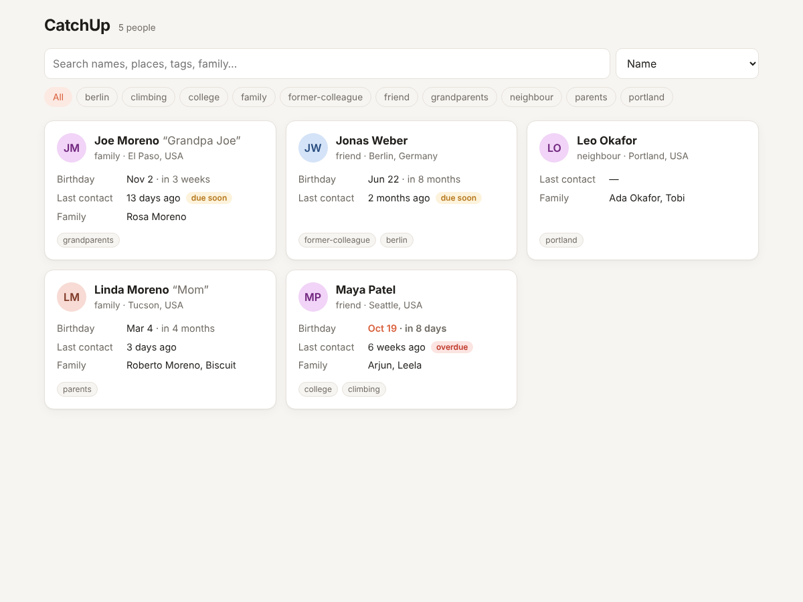

# CatchUp

A simple, no-fuss way to keep in touch with friends and family.

CatchUp is a directory of the people who matter to you — birthdays, family, how you met,
when you last spoke — stored as **plain Markdown files** you (or an AI agent) can edit
with any tool, and rendered as a friendly app.



## Getting started

```bash
npm install
npm run dev        # open the printed URL; edits to people/*.md show up instantly
```

Add someone by copying `people/_template.md` to `people/first-last.md`. The format is
documented in [docs/data-format.md](docs/data-format.md).

```markdown
---
name: Maya Patel
relationship: friend
tags: [college, climbing]
birthday: 1991-10-19
cadence: monthly
family:
  - name: Leela
    relation: daughter
---

Loves anything matcha.

## Log

### 2026-08-30 · Video call
- Leela started preschool.
```

The files in `people/` are fictional examples — replace them with your own.

## What it does today

- **Directory** of cards with birthday countdown, last contact, family and tags.
- **Search** across names, places, tags and family members; filter by tag; sort by name,
  upcoming birthday, or longest since contact.
- **Detail page** per person with contact links, family, notes and the conversation log.
- **Keep-in-touch cadence**: set `cadence: monthly` and the card shows *due soon* / *overdue*.
- **Validation** (`npm run validate`) so humans and agents get clear feedback on typos.

## Scripts

| Command | |
| --- | --- |
| `npm run dev` | Start the app with hot reload |
| `npm run validate` | Check every file in `people/` |
| `npm test` | Unit tests |
| `npm run build` | Typecheck and build a static site to `dist/` |

## Roadmap

- Quick "log a catch-up" from the app (writes to the person's file)
- "Who to reach out to" suggestions based on cadence, birthdays and follow-ups
- Scheduling help and reminders
